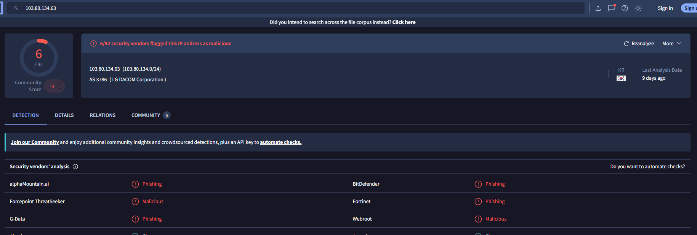
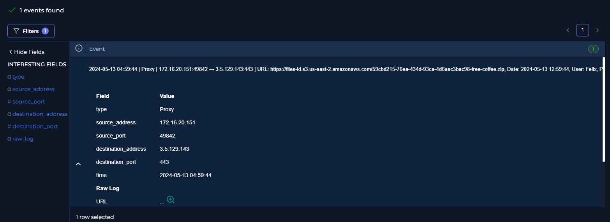
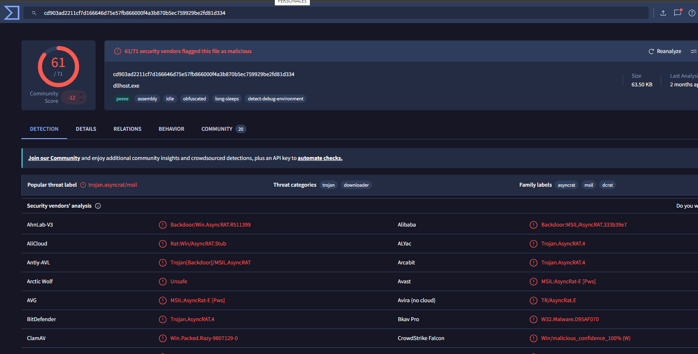
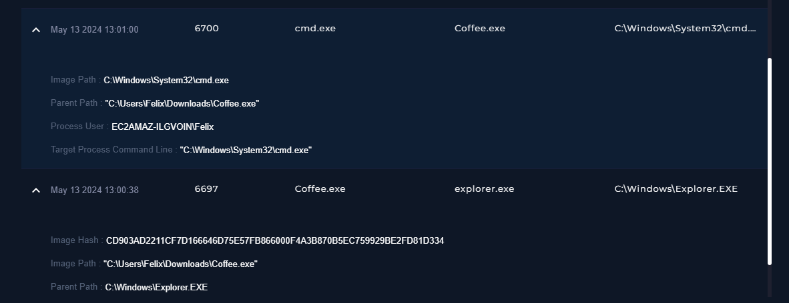
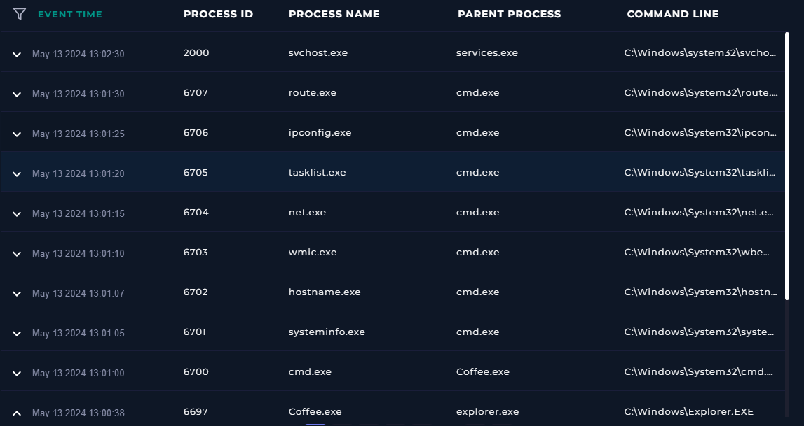
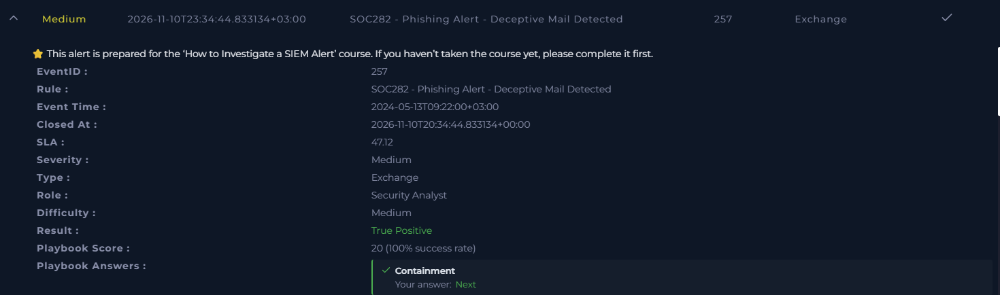

# SOC282 – Phishing Alert: Deceptive Mail Detected

## Case Overview

| Field | Details |
|---|---|
| Platform | LetsDefend |
| Event ID | 257 |
| Alert | SOC282 – Phishing Alert – Deceptive Mail Detected |
| Event time | 2024-05-13 09:22:00 (UTC+03:00, as displayed by LetsDefend) |
| Severity | Medium |
| Alert type | Exchange |
| Difficulty | Medium |
| Analyst role | Security Analyst |
| Final verdict | **True Positive** |
| Playbook score | **20/20 (100%)** |

## Executive Summary

The investigation confirmed a phishing email using a free-coffee-voucher lure. The message was sent from `free@coffeeshooop.com` to `Felix@letsdefend.io` with the subject **Free Coffee Voucher**.

The recipient-associated proxy log recorded a request to download `free-coffee.zip` from an Amazon S3-hosted URL. Endpoint process telemetry subsequently recorded `Coffee.exe` running from Felix's Downloads directory. The executable's SHA-256 hash received 61/71 detections on VirusTotal and was labeled `trojan.asyncrat/msil`.

Process telemetry further showed `Coffee.exe` spawning `cmd.exe`, followed by several Windows discovery utilities. This confirms malware execution and post-execution discovery activity on the investigated endpoint.

The available evidence does not, by itself, establish successful command-and-control communication, credential theft, or data exfiltration. Those outcomes should not be claimed without additional telemetry.

## Email and Delivery Indicators

| Indicator | Observed value |
|---|---|
| Sender | `free@coffeeshooop.com` |
| Recipient | `Felix@letsdefend.io` |
| Subject | `Free Coffee Voucher` |
| Attachment | `freecoffee.zip` |
| Source IP | `103.80.134.63` |
| Source IP reputation | 6/92 VirusTotal vendors flagged the IP |
| Proxy destination | `3.5.129.143:443` |
| Proxy username | `Felix` |
| Proxy timestamp | `2024-05-13 04:59:44` (as displayed in the log) |
| Download URL | `https://files-ld.s3.us-east-2.amazonaws.com/59cbd215-76ea-434d-93ca-4d6aec3bac98-free-coffee.zip` |

The source IP `103.80.134.63` had 6/92 VirusTotal detections, including multiple phishing-related classifications. The proxy event associated with Felix recorded a request to the attachment URL.

The S3 hostname is an Amazon hosting endpoint; its presence alone is not evidence that Amazon's infrastructure is malicious. The suspicious context is the specific attachment URL and its relationship to the phishing message.

## Endpoint Execution Evidence

Endpoint process telemetry recorded:

| Time (2024-05-13) | PID | Process | Parent process |
|---|---:|---|---|
| 13:00:38 | 6697 | `Coffee.exe` | `explorer.exe` |
| 13:01:00 | 6700 | `cmd.exe` | `Coffee.exe` |
| 13:01:05 | 6701 | `systeminfo.exe` | `cmd.exe` |
| 13:01:07 | 6702 | `hostname.exe` | `cmd.exe` |
| 13:01:10 | 6703 | `wmic.exe` | `cmd.exe` |
| 13:01:15 | 6704 | `net.exe` | `cmd.exe` |
| 13:01:20 | 6705 | `tasklist.exe` | `cmd.exe` |
| 13:01:25 | 6706 | `ipconfig.exe` | `cmd.exe` |
| 13:01:30 | 6707 | `route.exe` | `cmd.exe` |

`Coffee.exe` was observed at:

`C:\Users\Felix\Downloads\Coffee.exe`

The process ran under the Felix user account. It created `cmd.exe`, which then launched Windows utilities commonly used to inspect the host, users or network configuration, running processes, and routing information.

This activity is consistent with system and network discovery. The process names alone do not reveal the exact arguments or output of each command.

## Malware Hash Analysis

| Field | Value |
|---|---|
| Observed process name | `Coffee.exe` |
| SHA-256 | `CD903AD2211CF7D166646D75E57FB866000F4A3B870B5EC759929BE2FD81D334` |
| VirusTotal detection ratio | **61/71** |
| VirusTotal file name | `dllhost.exe` |
| Popular threat label | `trojan.asyncrat/msil` |
| Threat categories | Trojan, Downloader |
| Family labels | AsyncRAT, MSIL, DCRAT |

The SHA-256 observed in the endpoint process event matches the hash submitted to VirusTotal. VirusTotal's reported file name differs from the endpoint process name. File names can be changed; the hash is the stronger identifier for correlating the same file content.

The high detection ratio and AsyncRAT-related classification strongly support treating the executable as malicious.

## MITRE ATT&CK Mapping

| Technique | Name | Evidence / rationale |
|---|---|---|
| T1566.002 | Spearphishing Link | Phishing email delivered with a link/attachment lure leading to a malicious download. |
| T1204 | User Execution | The executable was launched under the recipient's user account. |
| T1059 | Command and Scripting Interpreter | `Coffee.exe` spawned `cmd.exe`. |
| T1082 | System Information Discovery | `systeminfo.exe`, `hostname.exe`, and `wmic.exe` appeared in the process sequence. |
| T1016 | System Network Configuration Discovery | `ipconfig.exe` and `route.exe` were launched. |
| T1057 | Process Discovery | `tasklist.exe` was launched. |

Technique mapping is based on observed behavior and should be treated as an analytical mapping, not proof of every capability of the malware.

## Analyst Assessment

**Verdict: TRUE POSITIVE**

The evidence supports a confirmed phishing incident with malware execution on Felix's workstation:

1. A deceptive voucher email was sent to the user.
2. Proxy telemetry recorded access to the attachment download URL by the Felix account.
3. Endpoint telemetry recorded `Coffee.exe` executing from the user's Downloads directory.
4. The executable's SHA-256 hash was flagged by 61/71 VirusTotal vendors, with an AsyncRAT-related threat label.
5. `Coffee.exe` spawned `cmd.exe`, which launched multiple system and network discovery utilities.

The investigation confirms execution and reconnaissance-like behavior. The evidence collected in this case does not independently confirm C2 communication, credential theft, persistence, lateral movement, or data exfiltration.

## Response and Playbook

LetsDefend recorded the final result as **True Positive**, with a playbook score of **20/20 (100%)**.

The final analyst assessment identified the incident as a phishing email with confirmed malware execution. Any additional containment, eradication, or recovery actions should be documented only when supported by the corresponding response records.

## Evidence Screenshots

### 1. Alert overview

### 2. Proxy event for the attachment URL

### 3. VirusTotal hash analysis

### 4. Coffee.exe spawning cmd.exe

### 5. Subsequent discovery process sequence

### 6. Final LetsDefend assessment

## Key Lessons

- Correlate email, proxy, threat-intelligence, and endpoint process telemetry to build an incident timeline.
- Use file hashes rather than filenames as the primary way to correlate malware samples.
- A legitimate Windows utility can be used by malware for discovery; process context and parent-child relationships matter.
- Distinguish confirmed execution from unproven impact. Do not claim C2, credential theft, or exfiltration without supporting evidence.

