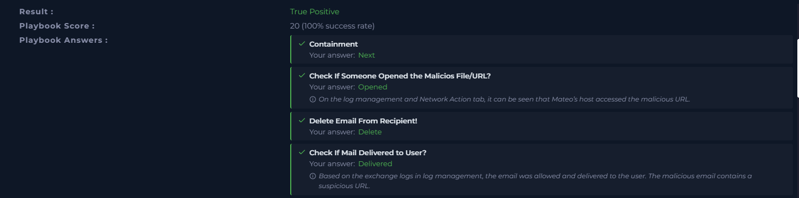
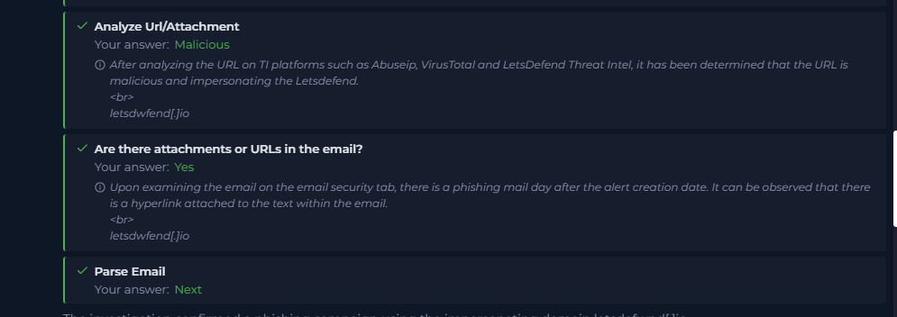

# SOC326 – Impersonating Domain MX Record Change Detected

## Case Overview

| Field | Details |
|---|---|
| Platform | LetsDefend |
| Event ID | `304` |
| Alert | `SOC326 - Impersonating Domain MX Record Change Detected` |
| Alert date | `2024-09-17 12:05:00 (+03:00)` |
| Severity | Medium |
| Difficulty | Medium |
| Alert category | ThreatIntel |
| Final classification | **True Positive** |
| Playbook score | **20/20 (100% success rate)** |

## Executive Summary

The investigation confirmed phishing activity involving the lookalike domain `letsdefwnd[.]io`, impersonating the legitimate `letsdefend.io` domain.

Threat intelligence reported a change to the suspicious domain's MX record. Subsequent email investigation identified a phishing message sent from `voucher@letsdefwnd.io` to `mateo@letsdefend.io`. The message used a voucher-themed lure and contained a link to `http://letsdefwnd.io/`.

Mateo's browser history recorded a visit to `http://www.letsdefwnd.io/`, establishing that the recipient accessed the suspicious domain. The available evidence did not establish credential submission, credential theft, or malware execution.

The malicious email was deleted and Mateo's workstation was contained. The alert was classified as a **True Positive**.

## Alert Details

| Field | Value |
|---|---|
| Event ID | `304` |
| Event time | `2024-09-17T12:05:00+03:00` |
| Rule | `SOC326 - Impersonating Domain MX Record Change Detected` |
| Domain | `letsdefwnd[.]io` |
| Reported MX record | `mail.mailerhost[.]net` |
| Device action | Allowed |
| Source address in alert | `no-reply@cti-report.io` |
| Destination address | `soc@letsdefend.io` |
| Trigger reason | The MX record of a suspicious domain changed, suggesting potential phishing activity |

## Investigation Timeline

| Date / time | Finding |
|---|---|
| 2024-09-17 12:05 (+03:00) | SOC326 alert generated for a suspicious MX record change. |
| 2024-09-18 00:00 | Phishing email from `voucher@letsdefwnd.io` to `mateo@letsdefend.io` was recorded as Allowed. |
| 2024-09-18 13:32:13 | Browser history recorded `http://www.letsdefwnd.io/`. |
| 2024-09-18 01:32:13 | Network Action log recorded destination `45.33.23.183`. The log display differs by 12 hours from the browser-history timestamp; timezone alignment was not established, so exact simultaneity is not asserted. |
| During investigation | Malicious email deleted and Mateo's workstation contained. |

## Evidence and Findings

### 1. Threat Intelligence – Domain Impersonation

The threat-intelligence email associated with incident `304` identified:

- Phishing domain: `letsdefwnd[.]io`
- Brand keywords: `letsdefend`, `similarity`
- Risk level: HIGH
- MX record: `mail.mailerhost[.]net`
- Phishing status: Action Waiting
- Registrar: Sav.com, LLC
- Domain state: NOT PARKED

The suspicious domain differs from `letsdefend.io` by replacing the letter `e` with `w`. Although these letters are adjacent on a QWERTY keyboard and a typo is conceivable, the later phishing email and browser-history evidence established malicious use in this incident.

### 2. Phishing Email Identified

| Field | Value |
|---|---|
| Sender | `voucher@letsdefwnd.io` |
| Recipient | `mateo@letsdefend.io` |
| Subject | `Congratulations! You've Won a Voucher` |
| Sender IP shown in email record | `172.16.20.3` |
| Date | `2024-09-18 00:00:00` |
| Mail action | Allowed |
| Embedded URL | `http://letsdefwnd.io/` |

The email used a voucher-reward lure and directed the recipient to the suspicious domain. The message was delivered because the mail action was Allowed.

### 3. Browser History – User Interaction

Mateo's browser history contained:

`http://www.letsdefwnd.io/`

Recorded time: `2024-09-18 13:32:13`

This is direct evidence that the suspicious domain was accessed from the user's workstation. It does not, by itself, prove that credentials were entered or that a payload was executed.

### 4. Network Activity

The workstation's Network Action tab showed three destination addresses:

| Destination | VirusTotal observation | Assessment |
|---|---|---|
| `169.254.169.254` | 0/92; tagged private and link-local | Not a malicious indicator by itself; commonly used for cloud metadata services. |
| `45.33.23.183` | 3/92 vendors flagged it; ASN AS63949, Akamai Connected Cloud | Suspicious IP reputation. Its relationship to the phishing visit is not conclusively established. |
| `23.44.17.219` | 0/92; ASN AS16625, Akamai Technologies | No direct vendor detections in the displayed report. |

The network event for `45.33.23.183` was displayed at `01:32:13`, while browser history displayed `13:32:13`. Because the timezone relationship was not established, this report records the timestamp discrepancy rather than treating the events as definitively simultaneous.

### 5. VirusTotal and External Reputation Checks

The investigation checked the suspicious domain, reported MX hostname, associated IP addresses, and workstation network destinations.

Key observations:

- `letsdefwnd.io`: 0/92 vendor detections in the displayed VirusTotal result.
- `mail.mailerhost.net`: 0/92 direct detections; VirusTotal also displayed detected files communicating with this hostname.
- `161.35.84.83`: 0/92; DigitalOcean infrastructure.
- `5.161.133.13`: 0/92; Hetzner infrastructure.
- `45.33.23.183`: 3/92 detections.
- `23.44.17.219`: 0/92 detections.
- `172.16.20.3`: private IP address; 0/92 in the displayed lookup.

VirusTotal also showed relationships between some infrastructure and detected files. Those relationships were not independently tied to this incident and were not treated as proof of malicious communication. A 0/92 result was not considered proof that an indicator was benign.

### 6. Endpoint Process Review

The endpoint process logs included common Windows processes such as:

- `winlogon.exe`
- `smss.exe`
- `svchost.exe`
- `services.exe`
- `AtBroker.exe`
- `TrustedInstaller.exe`
- `chrome.exe`

A `tvnserver.exe` process was also visible and was noted for review because it is commonly associated with TightVNC remote-access software. The available evidence did not establish that this process was malicious or connected to the phishing activity.

## Indicators of Compromise (IOCs)

| Type | Indicator | Context |
|---|---|---|
| Domain | `letsdefwnd[.]io` | Phishing / brand impersonation domain |
| URL | `http://letsdefwnd.io/` | Link embedded in phishing email |
| URL | `http://www.letsdefwnd.io/` | URL recorded in browser history |
| Email sender | `voucher@letsdefwnd.io` | Phishing email sender |
| Email recipient | `mateo@letsdefend.io` | Target recipient |
| IP address | `45.33.23.183` | Suspicious reputation; 3/92 detections, relationship to incident not conclusively established |
| MX hostname | `mail.mailerhost[.]net` | MX record reported by threat intelligence |

## Response and Containment Actions

The following actions were performed during the investigation:

1. **Email removal:** The malicious email was deleted.
2. **Endpoint containment:** Mateo's workstation was contained to limit further exposure while the investigation continued.
3. **IOC documentation:** The suspicious IP, URL, and sender email were added as artifacts in the LetsDefend workflow.

Containment does not mean the endpoint was fully eradicated or restored. Further investigation would be required to determine whether credentials were submitted, whether any payload was delivered, and whether additional remediation is necessary.

## Playbook Results

| Playbook check | Recorded answer |
|---|---|
| Containment | Next |
| Check if someone opened the malicious file/URL | Opened |
| Delete email from recipient | Delete |
| Check if mail delivered to user | Delivered |
| Analyze URL/attachment | Malicious |
| Are there attachments or URLs in the email? | Yes |
| Parse email | Next |

**Final result:** True Positive  
**Playbook score:** 20/20 (100% success rate)

The playbook explanation specifically noted that Mateo's host accessed the malicious URL and that the email was allowed and delivered.

## L1 Assessment

**Classification: TRUE POSITIVE**

The alert was a true positive because the investigation identified a phishing email using the impersonating domain and confirmed access to that domain from the recipient's workstation.

Confirmed:
- Phishing email delivered to Mateo.
- Suspicious URL included in the email.
- Browser history recorded access to the suspicious domain.
- Malicious email deleted.
- Workstation contained.

Not confirmed:
- Credential submission or theft.
- Malware download or execution.
- Full endpoint compromise.
- A conclusive link between `45.33.23.183` and the phishing website.

## Recommended Follow-up

- Escalate for further endpoint investigation to determine whether credentials were entered or files were downloaded.
- Review authentication activity for Mateo's account after the phishing interaction.
- Consider password reset and session revocation if credential exposure is suspected.
- Review the contained workstation before returning it to service.
- Continue monitoring the lookalike domain and related infrastructure.
- Preserve relevant email, browser, endpoint, and network evidence.

## Lessons Learned

This case highlights the importance of searching for related phishing activity **after the alert creation date**. The initial threat-intelligence alert and external reputation checks were not sufficient on their own. The decisive evidence came from correlating the later phishing email with Mateo's browser history.

A low VirusTotal detection ratio does not establish that a domain is safe. Incident classification must be based on the full set of available evidence.

## Playbook Evidence Screenshots

### Playbook results – email delivery, URL access, and containment

### Playbook results – malicious URL analysis and phishing email

